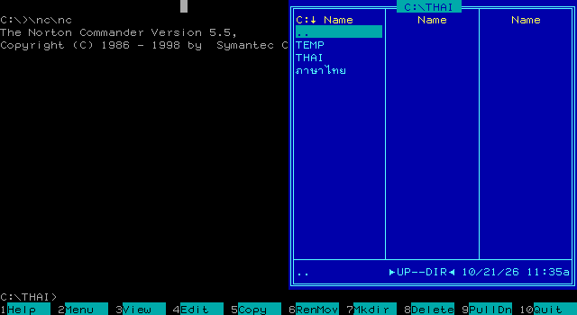

# GThai VGA

ไดรเวอร์ภาษาไทยสำหรับ DOS รุ่น **3.38** ใช้ VGA 640×480 สี 16 สี และฟอนต์ 8×19 จุด มีสองรุ่นจาก source เดียวกัน: รุ่น 8086 และรุ่น 386 ขึ้นไป

## ประวัติและเครดิต

**VTHAI เป็นผลงานของคุณวิชัย ปฏิภาภรณ์ (Wichai Patipaporn)**

Gary Butler นำโปรแกรม VTHAI มา disassemble แก้ไขให้รองรับเครื่องพิมพ์ IBM และพัฒนาต่อเป็น **GTHAI** ส่วนโครงการนี้พัฒนาต่อจาก GThai 3.12 เพื่อปรับการแสดงผลเป็น VGA Graphics Mode และแก้ไขข้อบกพร่องเพิ่มเติม

VTHAI/GTHAI รุ่นเดิมใช้ **EGA Graphics Mode 640×350** กับฟอนต์ **8×14 จุด** บนการ์ด EGA และ VGA และมีส่วนรองรับ Hercules แยกต่างหาก โครงการนี้เปลี่ยนการแสดงผลเป็น **VGA Graphics Mode 640×480** กับฟอนต์ **8×19 จุด** เพื่อเพิ่มรายละเอียดของตัวอักษร และตัดส่วนรองรับ Hercules และ EGA ออก

### ที่มาของฟอนต์

ฟอนต์ชุดปรับปรุงนำรูปอักษรจากหลายแหล่งมาประกอบและปรับแต่งให้เหมาะกับขนาด 8×19 จุด ได้แก่

- ระบบภาษาไทย **AxTHAI**
- ระบบภาษาไทย **ThaiPro**
- **AST ROM BIOS Font**

### การแก้ไขเพิ่มเติมจาก GTHAI เดิม

- แก้ไขการทำงานร่วมกับ **Microsoft EDIT** ให้แสดงหน้าจอได้ครบ
- แก้ไขการทำงานร่วมกับ **Norton Commander** ให้แสดงผลได้ถูกต้อง
- เพิ่มการตรวจ `░ ▒ ▓` แนวตั้ง และตรวจขอบแถว/จอเพื่อไม่ให้อ่านข้ามพื้นที่ข้อความ
- ปรับการตรวจเส้นกรอบโดยใช้สีของช่องข้างเคียงร่วมกับบริบทตัวอักษร

## English summary

**GThai VGA** is a DOS Thai display and printer driver updated for **VGA 640×480, 16 colours, and 8×19-pixel fonts**, with two executables built from the same source: **GTHAI.COM** for 8086-class CPUs and **GTHAI386.COM** for 386 or newer CPUs.

The original **VTHAI** was created by **Wichai Patipaporn**. **Gary Butler** disassembled VTHAI, added IBM printer support, and developed it into **GTHAI**. This project builds on GThai 3.12, updates its graphics display, and fixes additional compatibility issues.

The original EGA/VGA display path used **EGA graphics mode at 640×350 with 8×14-pixel fonts**, alongside a separate Hercules display path. This project switches to **VGA graphics mode at 640×480 with 8×19-pixel fonts** for more detailed glyphs and removes Hercules and EGA support.

The revised fonts combine and adapt glyphs from **AxTHAI**, **ThaiPro**, and **AST ROM BIOS Font**. Fixes improve display compatibility with **Microsoft EDIT** and **Norton Commander**. Frame and shading detection uses character context, checks screen boundaries, and considers neighbouring cell colours when identifying vertical lines.

Display options include English, Thai 8-line mode without automatic vowel/tone composition, and Thai 25-line mode with composition. The settings dialog supports the taller fonts, and the Thai cursor spans the full character height.

Both executables provide the same features and fonts; load only one at a time. Version 3.38 also batches VGA register state in Thai 8-line mode, reseeding latches for every glyph and restoring VGA state on all exits. It keeps the existing non-composing layout. Version 3.37 uses REP MOVSD in the 386 build for 160-byte row staging and snapshot copies, with 16-bit addresses and counts. The 8086 build retains MOVSW. Version 3.36 replaces three frame/shading row-boundary divisions with a 250-byte lookup table. This has not demonstrated a speedup on the emulated 386; real 8086 timing remains unmeasured. Version 3.35 redraws only changed output cells for eligible rows with at most eight changed source cells. ASCII rows compare character/colour pairs; composed Thai rows use exact six-byte rendering descriptors and a 480-byte cache for the most recently updated complex row. Dense changes and rows starting with spaces retain full-row rendering. Rebuilding a cold Thai row cache has additional cost.  Version 3.34 can stage a changed text row in RAM and reuse background latches within interrupt-masked groups of at most eight glyphs. Sparse row starts and immediately alternating backgrounds retain the direct path; frame detection still uses the original B800 context. Version 3.33 groups consecutive spaces with the same background colour during Thai 25-line screen updates, while preserving vowel compensation and falling back to the per-cell writer when the first two backgrounds differ. Version 3.32 fixes popup dialogs inheriting interrupted batch state and protects individual VGA glyph updates from interrupts. Version 3.31 reduces repeated VGA register setup during Thai 25-line screen updates in both builds, while the 386 build also compares text using `CMPSD`. The 386 build remains a 16-bit DOS real-mode program, uses 32-bit instructions for glyph copying and composition, and preserves the interrupted program’s upper register bits. VGA drawing and latch scrolling remain byte-based. In the version 3.30 DOSBox-X comparison on the same emulated 386, it reduced Thai composition time by **23.1%** and composed Thai drawing time by **9.2%**. These are emulator microbenchmarks, not real-hardware measurements; see the [benchmark report](docs/BENCHMARK.md).

## ความสามารถ

- แสดงข้อความ 80 คอลัมน์ × 25 แถว รองรับโหมดอังกฤษ ไทย 8 บรรทัด (ไม่ผสมสระ–วรรณยุกต์อัตโนมัติ) และไทย 25 บรรทัด
- ผสมพยัญชนะ สระ และวรรณยุกต์ โดยยกวรรณยุกต์เมื่อมีสระบน
- ตรวจเส้นกรอบและแรเงา ทั้งแนวนอนและแนวตั้ง ใช้สีช่องข้างเคียงช่วยตรวจเส้นตั้ง
- หน้าตั้งค่ารองรับฟอนต์ 8×19 จุด และ cursor ไทยสูงเต็มตัวอักษร
- รุ่น 3.32 ยกเลิกสถานะวาดเป็นชุดก่อนเปิดหน้าต่าง และกัน interrupt ระหว่างเขียนอักษรหนึ่งตัว เพื่อป้องกันข้อความปุ่มเสียเมื่อเปิดหน้าต่างแทรกการวาดจอ

ส่วนแสดงผลใช้ VGA mode 12h โดยไม่มี backend Hercules/EGA

## เปรียบเทียบภาพ EGA และ VGA

แสดง screenshot จากไฟล์ PNG ต้นฉบับโดยไม่ปรับขนาดหรือยืดสัดส่วน: EGA มีขนาด **640×350** และ VGA มีขนาด **640×480** จึงมีความสูงต่างกัน คลิกภาพเพื่อเปิดไฟล์ต้นฉบับได้

### Norton Commander

**VTHAI/GTHAI เดิม EGA — 640×350, ฟอนต์ 8×14 จุด**

<a href="docs/images/norton-commander-ega.png"></a>

**GTHAI VGA — 640×480, ฟอนต์ 8×19 จุด** (ภาพจาก GThai 3.28)

<a href="docs/images/norton-commander-vga.png"></a>

### หน้าตั้งค่า

**VTHAI/GTHAI เดิม EGA — GThai 3.12, ฟอนต์ 8×14 จุด**

<a href="docs/images/settings-ega.png"></a>

**GTHAI VGA — ฟอนต์ 8×19 จุด** (ภาพจาก GThai 3.22)

<a href="docs/images/settings-vga.png"></a>

## ใช้งานบน DOS

เลือกโปรแกรมให้ตรงกับ CPU แล้วนำไปไว้ในเครื่อง DOS หรือไดรฟ์ที่ mount ใน DOSBox-X:

| โปรแกรม | CPU | ส่วนผสมฟอนต์ |
|---|---|---|
| `output/GTHAI.COM` | 8086 ขึ้นไป | คำสั่ง 16-bit |
| `output/GTHAI386.COM` | 386 ขึ้นไป | ใช้ EAX ผสมครั้งละ 32-bit |

ทั้งสองรุ่นมีความสามารถ ฟอนต์ และการตั้งค่าเหมือนกัน เลือก `GTHAI.COM` สำหรับ 8086/8088/186/286 หรือเลือก `GTHAI386.COM` สำหรับ 386 ขึ้นไปที่ต้องการส่วนผสมฟอนต์ที่เร็วขึ้น ทั้งสองรุ่นต้องใช้การ์ด VGA

ติดตั้งเพียงตัวเดียว โดยรุ่นปกติเรียก:

```dos
GTHAI
```

หรือสำหรับเครื่อง 386 ขึ้นไป:

```dos
GTHAI386
```

รุ่น 386 ยังคงทำงานใน DOS real mode แบบ 16-bit และตรวจ CPU ก่อนติดตั้ง การผสมฟอนต์ใช้คำสั่ง 32-bit โดยรักษาค่า register ส่วนบนของโปรแกรมเดิม ส่วนการเขียน VGA และการเลื่อนภาพด้วย latch ยังเป็นแบบไบต์ จึงไม่ใช่การเขียน VGA ครั้งละ 32-bit

- ปุ่ม `` ` ``: สลับแป้นพิมพ์ไทย/อังกฤษ
- Ctrl + backtick: เปิดหน้าตั้งค่า
- Alt + backtick: เปิดหน้าถอดไดรเวอร์
- `GTHAI U` หรือ `GTHAI386 U`: ถอดไดรเวอร์จากบรรทัดคำสั่ง เมื่อไม่มีโปรแกรมอื่น hook interrupt ต่ออยู่

หากมีไดรเวอร์รุ่นเก่าค้างอยู่ ให้ถอดรุ่นเก่าหรือเริ่ม DOS ใหม่ก่อนโหลดรุ่นนี้

## Build

ต้องมี PowerShell และ JWasm ที่รองรับ `INCBIN`:

```powershell
.\build.ps1 -Assembler C:\tools\jwasm.exe
```

ถ้า JWasm อยู่ใน PATH เรียก `./build.ps1` ได้เลย build ครั้งเดียวได้ `output/GTHAI.COM` และ `output/GTHAI386.COM` พร้อม listing แยกที่ `work/GTHAI.lst` และ `work/GTHAI386.lst`

รุ่นปกติใช้ `.8086` ส่วนรุ่น 386 กำหนด `CPU_386=1` ให้ assembler และใช้ `.386` โดยทั้งคู่กำหนด code segment เป็น `USE16` อย่างชัดเจน การ build จะประกอบทั้งสองตัวให้ผ่านก่อนแทนที่ไฟล์ใน `output/`

ฟอนต์ทั้งสองชุดเป็น bitmap ดิบ ไม่ใช่ฟอนต์ Windows:

| ไฟล์ | ขนาด |
|---|---:|
| `fonts/GTHAI1-19.FON` | 4,864 ไบต์ |
| `fonts/GTHAI2-19.FON` | 4,864 ไบต์ |

แต่ละชุดมี 256 ตัว × 19 ไบต์ แก้ฟอนต์แล้ว build ได้โดยตรง โค้ดใช้แมโคร `INCLUDEBIN` เรียก `INCBIN` ของ JWasm และใช้ตารางตำแหน่งร่วม 512 ไบต์ ไม่มี padding 13 ไบต์ต่อตัว

## ทดสอบ

ต้องมี Python และติดตั้ง dependency สำหรับทดสอบ:

```powershell
python -m pip install -r requirements-dev.txt
python tests/run_all.py
```

ให้ build ก่อนทดสอบ ตัวรันจะทดสอบทั้งสอง executable รวมถึงการรักษา register 32-bit และการตรวจ CPU ชุดทดสอบรันคำสั่งของ COM จริงในโหมด 16-bit ผ่าน Unicorn ร่วมกับแบบจำลองหน่วยความจำ VGA ตรวจฟอนต์ สี การผสมอักขระ cursor การเลื่อนจอ การสลับโหมด และขอบเขตการอ่านแรเงา

เคยตรวจการทำงานด้วย DOSBox-X รวมถึงหน้าตั้งค่า EDIT และการออกจาก VALET รวมถึงตรวจติดตั้งรุ่นปกติบน CPU 8086, รุ่น 386 บน CPU 386 และการปฏิเสธรุ่น 386 บน CPU 286 แต่ยังไม่มีผลวัดเวลาบนการ์ด VGA จริง

## การแสดงผล

- ใช้ VGA write mode 3 และคลี่คำสั่งวาดทั้ง 19 แถว
- ทั้งสองรุ่นเก็บสถานะ VGA ระหว่างวาดอักษรต่อเนื่องในโหมดไทย 25 บรรทัด ลด `OUT` จาก 7 เหลือ 4 ครั้งหลังตัวแรก และคืนสถานะก่อนวาดช่องว่าง/cursor และเมื่อจบการอัปเดต
- รุ่น 386 ใช้ `REPE CMPSD` ตรวจข้อความครั้งละสองช่อง และตรวจซ้ำระดับ WORD เพื่อหาช่องแรกที่ต่างอย่างแม่นยำ
- วาดใหม่เฉพาะข้อมูลข้อความที่เปลี่ยน
- รุ่น 3.34 พักข้อมูลแถวใน RAM เมื่อสองช่องแรกไม่ใช่ช่องว่างและมีสีพื้นเหมือนกัน เพื่อลดการอ่าน B800 แทรก; บริบทตรวจกรอบยังอ่านต้นฉบับและยกเลิกการจำ latch ก่อนอ่าน
- จำ latch เฉพาะกลุ่มไม่เกิน 8 glyph ที่ปิด interrupt แล้วล้างค่าที่จำก่อนเปิด interrupt จึงไม่ใช้ latch ค้างข้าม interrupt handler อื่น
- รุ่น 3.33 วาดช่องว่างต่อเนื่องที่มีสีพื้นเหมือนกันเป็นชุด โดยคงการนับช่องสำหรับชดเชยสระเดิม; หากสองช่องแรกมีสีพื้นต่างกันจะใช้ลูปเดิมทั้งช่วง
- ย้ายพื้นที่ภาพเริ่มที่ offset E000h และวนผ่านขอบ 64 KB เพื่อเว้นพื้นที่ B800 สำหรับข้อความและสำรองจอ
- ใช้การคัดลอกแบบไบต์ในการเลื่อนภาพด้วย VGA latch

การตรวจกรอบใช้กฎจากบริบท จึงอาจตีความตัวอักษรไทยที่เรียงซ้ำและมีสีข้างเคียงเข้าเกณฑ์เป็นเส้นกรอบได้ พื้นที่แสดงผลข้อความรองรับ page 0

## ไฟล์ในโครงการ

| ตำแหน่ง | เนื้อหา |
|---|---|
| `GTHAI.ASM`, `GTHAI.INC` | source ไดรเวอร์ |
| `fonts/` | ฟอนต์ที่ฝังในโปรแกรม |
| `output/GTHAI.COM` | โปรแกรม DOS สำหรับ 8086 ขึ้นไป |
| `output/GTHAI386.COM` | โปรแกรม DOS สำหรับ 386 ขึ้นไป |
| `tests/` | ชุดทดสอบทั้ง GTHAI และ GTHAI386 |
| `tools/benchmark_dosbox.py` | เครื่องมือเทียบความเร็วทั้งสองรุ่นบน DOSBox-X |
| `docs/BENCHMARK.md` | วิธีวัดเวลา ผลทดสอบ และข้อจำกัด |
| `docs/benchmarks/` | ผลวัดดิบสำหรับตรวจสอบ |
| `docs/images/` | ภาพเปรียบเทียบ EGA และ VGA |
| `CHANGES.md` | สรุปการปรับปรุง |
| `API.md` | คำสั่ง INT 10h ของไดรเวอร์ พารามิเตอร์ และข้อจำกัดจาก source |

เครดิตในโปรแกรม: `Customization by Gary Butler, VGA mode by too101`


## ความแตกต่างด้านประสิทธิภาพของรุ่น 386

รุ่น 386 ใช้ DWORD ในการคัดลอกและ OR ฟอนต์ครั้งละ 4 แถว พร้อมคำสั่งเลื่อนบิต 4 ตำแหน่งในขั้นเตรียมสี รุ่นปกติยังใช้ WORD และคำสั่ง 8086 ทั้งหมด

| รูทีน | GTHAI | GTHAI386 |
|---|---:|---:|
| คัดลอก glyph 19 แถว | 23 คำสั่ง | 17 คำสั่ง |
| OR glyph 19 แถว | 24 คำสั่ง | 18 คำสั่ง |
| OR วรรณยุกต์ที่ยกขึ้น 3 แถว | 20 คำสั่ง | 14 คำสั่ง |

ตัวเลขมาจาก trace รูทีนใน COM รวมการคืน register แต่ไม่ใช่ผลวัดเวลา ความเร็วจริงขึ้นกับ CPU และบัสของเครื่อง รุ่น 3.31 เพิ่มการใช้สถานะ VGA ร่วมระหว่างวาดในทั้งสอง executable และใช้ CMPSD ตรวจจอเฉพาะรุ่น 386

ผลวัดรุ่น 3.30 ด้วย DOSBox-X บน CPU จำลอง 386 และค่า cycles เท่ากัน: รุ่น 386 ใช้เวลาผสมฟอนต์ลดลง 23.1% วาดข้อความไทยลดลง 9.2% และวาดอังกฤษลดลง 2.5% ดู [วิธีทดสอบและผลละเอียด](docs/BENCHMARK.md) ตัวเลขนี้เป็นผลในตัวจำลอง ยังไม่ได้วัดบนเครื่องจริง

ผล screen benchmark รุ่น 3.31 เดิมถูกถอนการอ้างอิง เนื่องจากตัววัดไม่ได้เปิด B800 mapping ให้ตรงกับไดรเวอร์ ดูผลวัดรุ่น 3.33 ด้วยตัววัดที่แก้แล้วใน [รายงานทดสอบ](docs/BENCHMARK.md)

รายละเอียดสำหรับโปรแกรม DOS ที่ต้องการเรียกไดรเวอร์อยู่ใน [API.md](API.md) โดยมีข้อจำกัดของ API เดิมที่ยังไม่ได้ทดสอบหรือแก้ครบทุกคำสั่ง

ผลวัดรุ่น 3.33 เทียบ 3.32 ใน DOSBox-X ด้วยตัววัดที่แก้ B800 mapping แล้ว: ช่องว่างยาวใช้เวลาลดลง 54.5% สำหรับ GTHAI และ 53.1% สำหรับ GTHAI386 ส่วนข้อความ A ผสมช่องว่างลดลง 42.0% และ 40.3% ตามลำดับ ดูรูปแบบข้อมูลและข้อจำกัดใน [รายงานทดสอบ](docs/BENCHMARK.md)

ผลรุ่น 3.34 เทียบ 3.33 ใน DOSBox-X: แถวอักษรสีเดียวใช้เวลาลดลง 17.5% / 14.9% สำหรับ GTHAI / GTHAI386 และข้อความไทยตัวอย่างลดลงประมาณ 5% กรณีสีพื้นสลับหรือข้อความที่มีช่องว่างมากบางแบบอาจช้าลงเล็กน้อย ดูผลครบทุกกรณีใน [รายงานทดสอบ](docs/BENCHMARK.md)

รุ่น 3.35 ลดการวาดซ้ำเมื่อเปลี่ยนไม่เกิน 8 ช่องในแถวที่เข้าเงื่อนไข โดยเทียบผลหลังจัดวางสระ–วรรณยุกต์ ใช้ข้อมูลระบุภาพ 6 ไบต์ต่อช่อง และเก็บแถวไทยล่าสุด 480 ไบต์ ผล DOSBox-X เมื่อแก้ซ้ำในแถวเดิม: อังกฤษเร็วขึ้นประมาณ 22–24% และไทยตัวอย่างประมาณ 10% กรณีต้องวาดเต็มแถวมีต้นทุนเพิ่ม ดู [ผลทดสอบ](docs/BENCHMARK.md)

รุ่น 3.36 ลด `DIV` สามจุดในการตรวจกรอบ/แรเงาด้วยตารางต้นแถว 250 ไบต์ ใช้ได้ทั้งสองรุ่น ผล DOSBox-X จำลอง 386 ยังไม่แสดงความเร็วเพิ่ม และยังไม่มีผลวัดบน 8086 จริง ดูรายละเอียดใน [รายงานทดสอบ](docs/BENCHMARK.md)

รุ่น 3.37 ใช้ `REP MOVSD` ใน GTHAI386 สำหรับพักแถวข้อความและสำรองลง `VID_SAVE` ครั้งละ 160 ไบต์ ผล DOSBox-X วาดใหม่ทั้งจอเร็วขึ้นประมาณ 1% ส่วน GTHAI ยังคงใช้ `MOVSW`

รุ่น 3.38 เพิ่ม batch สถานะ VGA ให้โหมดไทย 8 บรรทัดทั้งสองรุ่น โดยยังไม่ผสมสระ–วรรณยุกต์อัตโนมัติ โหลด latch ใหม่ทุกอักษร และคืนสถานะก่อนออกทุกทาง การวาดอังกฤษเต็มจอลด GC OUT จาก 14,000 เหลือ 8,003 ครั้ง ดู [ผลเวลา](docs/BENCHMARK.md)
