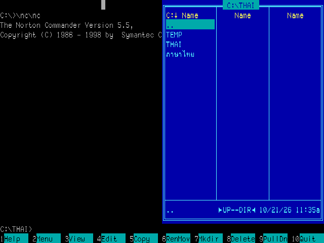
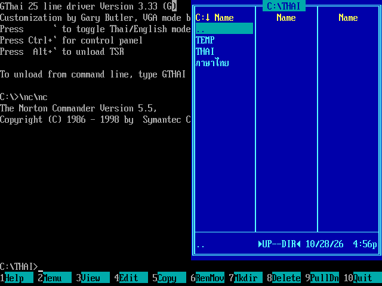
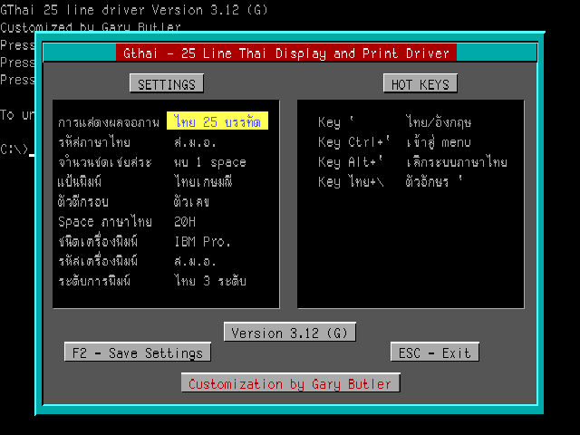
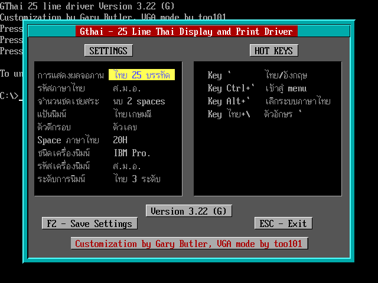

# GThai VGA

ไดรเวอร์ภาษาไทยสำหรับ DOS รุ่น **3.29 (G)** ใช้ VGA 640×480 สี 16 สี และฟอนต์ 8×19 จุด รองรับ CPU 8086 ขึ้นไป

## ประวัติและเครดิต

**VTHAI เป็นผลงานของคุณวิชัย ปฏิภาภรณ์ (Wichai Patipaporn)**

Gary Butler นำโปรแกรม VTHAI มา disassemble และพัฒนาต่อเป็น **GTHAI** โดยเริ่มจากการเพิ่มการรองรับเครื่องพิมพ์ IBM ส่วนโครงการนี้พัฒนาต่อจาก GThai 3.12 โดย too101 เพื่อปรับการแสดงผล VGA ฟอนต์ และแก้ไขข้อบกพร่องเพิ่มเติม

VTHAI/GTHAI รุ่นเดิมที่นำมาเปรียบเทียบใช้โหมด **EGA 640×350** กับฟอนต์ **8×14 จุด** โครงการนี้เปลี่ยนเป็น **VGA 640×480** กับฟอนต์ **8×19 จุด** เพื่อเพิ่มรายละเอียดของตัวอักษรและพื้นที่วางสระ–วรรณยุกต์ จึงไม่รองรับ Hercules และ EGA

### ที่มาของฟอนต์

ฟอนต์ชุดปรับปรุงนำรูปอักษรจากหลายแหล่งมาประกอบและปรับแต่งให้เหมาะกับขนาด 8×19 จุด ได้แก่

- ระบบภาษาไทย **AxTHAI**
- ระบบภาษาไทย **ThaiPro**
- **AST BIOS Font**

### การแก้ไขเพิ่มเติมจาก GTHAI เดิม

- **Microsoft EDIT:** แก้การคืนข้อมูลฟอนต์และจำนวนแถวให้แสดงหน้าจอได้ครบ
- **Norton Commander:** แก้การเก็บและคืนข้อมูลจอ รวมถึงการสลับโหมดอังกฤษ/ไทยที่อาจทำให้เกิดขยะบนจอ
- **อักษรแรเงา:** เพิ่มการตรวจ `░ ▒ ▓` แนวตั้ง และตรวจขอบแถว/จอเพื่อไม่ให้อ่านข้ามพื้นที่ข้อความ
- ปรับการตรวจเส้นกรอบโดยใช้สีของช่องข้างเคียงร่วมกับบริบทตัวอักษร

## English summary

**GThai VGA** is a DOS Thai display and printer driver updated for **VGA 640×480, 16 colours, and 8×19-pixel fonts**, while retaining compatibility with 8086-class CPUs.

The original **VTHAI** was created by **Wichai Patipaporn**. **Gary Butler** recreated its source through disassembly and developed **GTHAI**, initially adding IBM printer support. This project, maintained by **too101**, builds on GThai 3.12 and replaces its EGA 640×350 / 8×14 display path with VGA and taller, more detailed glyphs. Hercules and EGA adapters are no longer supported.

The revised fonts combine and adapt glyphs from **AxTHAI**, **ThaiPro**, and **AST BIOS Font**. Additional fixes improve Microsoft EDIT compatibility, screen preservation and mode switching with Norton Commander, and shading-character detection. The current defaults are **Epson printing** and **two-column vowel compensation**.

## ความสามารถ

- แสดงข้อความ 80 คอลัมน์ × 25 แถว รองรับโหมดอังกฤษ ไทย 8 บรรทัด และไทย 25 บรรทัด
- ผสมพยัญชนะ สระ และวรรณยุกต์ โดยยกวรรณยุกต์เมื่อมีสระบน
- ตรวจเส้นกรอบและแรเงา `░ ▒ ▓` ทั้งแนวนอนและแนวตั้ง
- ใช้สีช่องข้างเคียงช่วยตรวจเส้นตั้ง
- หน้าตั้งค่ารองรับฟอนต์ 8×19 จุด และ cursor ไทยสูงเต็มตัวอักษร
- ค่าเริ่มต้น: เครื่องพิมพ์ **Epson**, ชดเชยสระ **2 ช่อง**

ส่วนแสดงผลใช้ VGA mode 12h โดยไม่มี backend Hercules/EGA

## เปรียบเทียบภาพ EGA และ VGA

ภาพแต่ละคู่แสดงในขนาด **640×480 เท่ากัน** เพื่อเปรียบเทียบรายละเอียดตัวอักษรและสระ–วรรณยุกต์บนพื้นที่แสดงผลเดียวกัน ภาพ EGA ต้นฉบับมีขนาด 640×350 จึงจัดภาพเปรียบเทียบให้มีสัดส่วน 4:3 เช่นเดียวกับ VGA โดยเก็บไฟล์ภาพต้นฉบับไว้ครบ คลิกภาพเพื่อเปิดต้นฉบับได้

### Norton Commander

**EGA — 640×350, ฟอนต์ 8×14 จุด**

<a href="docs/images/norton-commander-ega.png"></a>

**VGA — 640×480, ฟอนต์ 8×19 จุด** (ภาพจาก GThai 3.28)

<a href="docs/images/norton-commander-vga.png"></a>

### หน้าตั้งค่า

**EGA — GThai 3.12, ฟอนต์ 8×14 จุด**

<a href="docs/images/settings-ega.png"></a>

**VGA — ฟอนต์ 8×19 จุด** (ภาพจาก GThai 3.22)

<a href="docs/images/settings-vga.png"></a>

## ใช้งานบน DOS

นำ `output/GTHAI.COM` ไปไว้ในเครื่อง DOS หรือไดรฟ์ที่ mount ใน DOSBox-X แล้วเรียก:

```dos
GTHAI
```

- ปุ่ม `` ` ``: สลับแป้นพิมพ์ไทย/อังกฤษ
- Ctrl + backtick: เปิดหน้าตั้งค่า
- Alt + backtick: เปิดหน้าถอดไดรเวอร์
- `GTHAI U`: ถอดไดรเวอร์จากบรรทัดคำสั่ง เมื่อไม่มีโปรแกรมอื่น hook interrupt ต่ออยู่

หากมีไดรเวอร์รุ่นเก่าค้างอยู่ ให้ถอดรุ่นเก่าหรือเริ่ม DOS ใหม่ก่อนโหลดรุ่นนี้

## Build

ต้องมี PowerShell และ JWasm ที่รองรับ `INCBIN`:

```powershell
.\build.ps1 -Assembler C:\tools\jwasm.exe
```

ถ้า JWasm อยู่ใน PATH เรียก `./build.ps1` ได้เลย ผลลัพธ์อยู่ที่ `output/GTHAI.COM` และ listing สำหรับตรวจสอบอยู่ที่ `work/GTHAI.lst`

ฟอนต์ทั้งสองชุดเป็น bitmap ดิบ ไม่ใช่ฟอนต์ Windows:

| ไฟล์ | ขนาด |
|---|---:|
| `fonts/GTHAI1-19.FON` | 4,864 ไบต์ |
| `fonts/GTHAI2-19.FON` | 4,864 ไบต์ |

แต่ละชุดมี 256 ตัว × 19 ไบต์ แก้ฟอนต์แล้ว build ได้โดยตรง โค้ดใช้แมโคร `INCLUDEBIN` เรียก `INCBIN` ของ JWasm และใช้ตารางตำแหน่งร่วม 512 ไบต์ ไม่มี padding 13 ไบต์ต่อตัว

## ทดสอบ

ต้องมี Python และติดตั้ง dependency สำหรับทดสอบ:

```powershell
python -m pip install -r requirements-dev.txt
python tests/verify_vga.py
python tests/verify_mode3.py
python tests/verify_packed19.py
python tests/verify_mode_switch.py
python tests/verify_vertical_shade.py
python tests/verify_colour_hint.py
```

ให้ build ก่อนทดสอบ ชุดทดสอบรันคำสั่ง 16-bit ของ COM จริงผ่าน Unicorn ร่วมกับแบบจำลองหน่วยความจำ VGA ตรวจฟอนต์ สี การผสมอักขระ cursor การเลื่อนจอ การสลับโหมด และขอบเขตการอ่านแรเงา

เคยตรวจการทำงานด้วย DOSBox-X รวมถึงหน้าตั้งค่า EDIT และการออกจาก VALET แต่ยังไม่มีผลวัดเวลาบนการ์ด VGA จริง

## การแสดงผล

- ใช้ VGA write mode 3 และคลี่คำสั่งวาดทั้ง 19 แถว
- วาดใหม่เฉพาะข้อมูลข้อความที่เปลี่ยน
- ย้ายพื้นที่ภาพเริ่มที่ offset E000h และวนผ่านขอบ 64 KB เพื่อเว้นพื้นที่ B800 สำหรับข้อความและสำรองจอ
- ใช้การคัดลอกแบบไบต์ในการเลื่อนภาพด้วย VGA latch

การตรวจกรอบใช้กฎจากบริบท จึงอาจตีความตัวอักษรไทยที่เรียงซ้ำและมีสีข้างเคียงเข้าเกณฑ์เป็นเส้นกรอบได้ พื้นที่แสดงผลข้อความรองรับ page 0

## ไฟล์ในโครงการ

| ตำแหน่ง | เนื้อหา |
|---|---|
| `GTHAI.ASM`, `GTHAI.INC` | source ไดรเวอร์ |
| `fonts/` | ฟอนต์ที่ฝังในโปรแกรม |
| `output/GTHAI.COM` | โปรแกรม DOS ที่ build แล้ว |
| `tests/` | ชุดทดสอบ |
| `docs/images/` | ภาพเปรียบเทียบ EGA และ VGA |
| `CHANGES.md` | สรุปการปรับปรุง |

เครดิตในโปรแกรม: `Customization by Gary Butler, VGA mode by too101`
